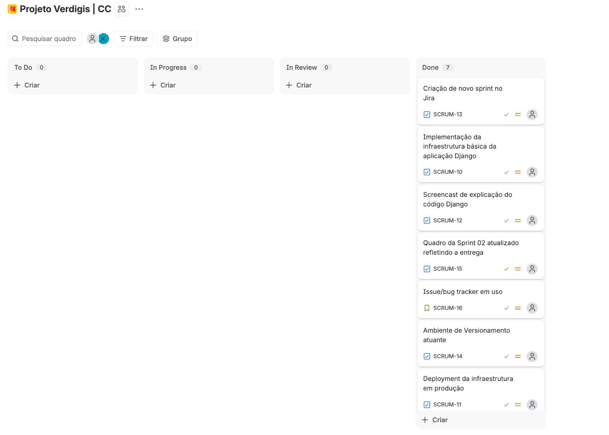

# Entregas do Projeto Verdigis

Repositório: [`Projeto-Verdigis`](https://github.com/jpedrosmenezes/Projeto-Verdigis)

## Índice

- [Entrega 01](#entrega-01)
- [Entrega 02](#entrega-02)

---

## Entrega 01

### Documentação
- [Benchmark - Análise de Competidores](./competitoranalysis/competitoranalysis.md)

### Backlog

### Quadro do 1º Sprint

---

## Entrega 02

### Quadro do 2º Sprint

### Site
- [Acessar o site](https://projeto-verdigis.onrender.com)

### Screencast de explicação do código Django
- [Assistir no YouTube](https://youtu.be/IaMJn3oHWg4)

> Legendas disponíveis no YouTube.